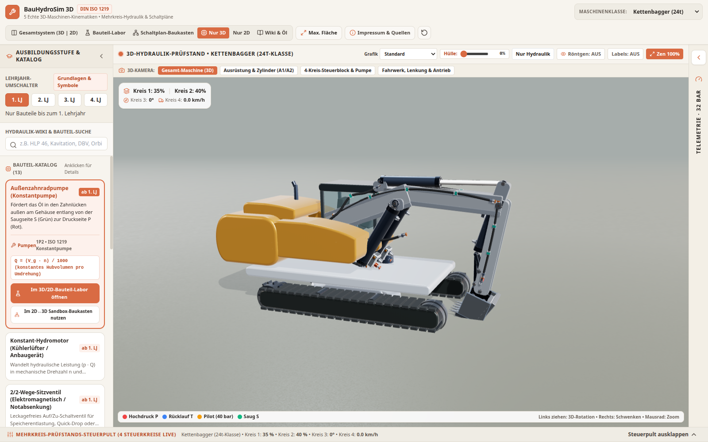
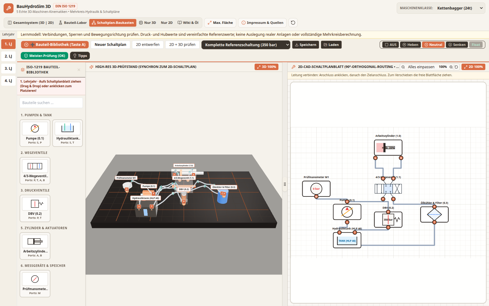

  

<h1 align="center">BauHydroSim 1.2 Alpha</h1>

<strong>Baumaschinenhydraulik anschaulich erkunden – vom Schaltzeichen bis zur 3D-Maschine.</strong> 
Kostenlose, deutschsprachige Lernsimulation für Auszubildende und Ausbilder.

  <a href="https://github.com/dennisdeckena-star/BauHydroSim-Download/releases/download/v1.2.2-alpha/BauHydroSim-Setup-x64-PRUEFKANDIDAT.exe">⬇️ Windows-Installer herunterladen</a>
  &nbsp;·&nbsp;
  <a href="https://github.com/dennisdeckena-star/BauHydroSim-Download/releases/download/v1.2.2-alpha/BauHydroSim-1.2.2-alpha-linux-amd64.snap">🐧 Ubuntu/Linux amd64 (Snap)</a>
  &nbsp;·&nbsp;
  <a href="https://github.com/dennisdeckena-star/BauHydroSim-Download/releases/download/v1.2.2-alpha/BauHydroSim-1.2.2-alpha-linux-amd64.snap.sha256">SHA-256</a>
  &nbsp;·&nbsp;
  <a href="https://github.com/dennisdeckena-star/BauHydroSim-Download/releases/download/v1.2.2-alpha/BauHydroSim_1.2_Alpha_Bedienungsanleitung_neu.pdf">📘 Deutsches Handbuch (PDF)</a>

## Die Simulation auf einen Blick

*Startansicht mit 3D-Kettenbagger, Bauteilkatalog und Lehrjahrfilter. Screenshot aus dem Ubuntu/Chromium-Build 1.2.2.*

Im **Schaltplan-Baukasten** lassen sich Hydraulikbauteile platzieren und verbinden. Die 2D-Schaltung kann anschließend gemeinsam mit der 3D-Lernansicht betrachtet werden.

Im Baukasten übernimmt der virtuelle Werkstattmeister die Prüfung. Die Anzeige **„Meister-Prüfung (OK)“** bedeutet, dass der Schaltplan die eingebauten Strukturprüfungen bestanden hat.

*2D/3D-Prüfansicht des Baukastens. Screenshot aus dem Ubuntu/Chromium-Build 1.2.2; die 3D-Komponentenansicht ist ein Lernmodell.*

## Funktionen

- **3D-Maschinenansicht:** Kettenbagger, Radlader, Muldenkipper und weitere Baumaschinenmodelle mit steuerbaren Lernbewegungen.
- **2D-Schaltplan-Baukasten:** Bauteile auswählen, auf dem Blatt platzieren, verbinden und als Lernschaltung untersuchen.
- **Hydraulik-Lernbereiche:** Bauteil-Wiki, Formeln, Öl-Labor und Diagnoseübungen.
- **Lehrjahre 1 bis 4:** Bauteilkatalog und Übungen passend zur gewählten Ausbildungsstufe.

## Download

Die Alpha **1.2.2** ist als Windows-x64-Installer und als Linux-amd64-Snap-Paket im selben [GitHub-Release](https://github.com/dennisdeckena-star/BauHydroSim-Download/releases/tag/v1.2.2-alpha) verfügbar. Das Linux-Paket verwendet Core 26. Die Paketstruktur wurde geprüft; eine Installation und ein Start unter Strict Confinement sind noch nicht verifiziert. Für den lokalen Download: `sudo snap install --dangerous ./BauHydroSim-1.2.2-alpha-linux-amd64.snap`.

## Hinweise zur Alpha

BauHydroSim ist eine Lernsimulation. Berechnungen und Maschinenmodelle sind didaktisch vereinfacht; der Baukasten ist kein universeller Solver für beliebige Hydrauliknetze. Die Software ist nicht zur Auslegung oder Sicherheitsfreigabe realer Anlagen bestimmt.

Die native Windows-11-Prüfung von Installation, Programmstart, Offlinebetrieb und Deinstallation für diesen Build steht noch aus. Der Installer ist unsigniert; Windows kann beim Start eine Sicherheits- oder Herkunftswarnung anzeigen.

## Rückmeldung

Was hilft beim Verstehen? Wo sind Bedienung oder Erklärung noch unklar? Rückmeldungen zu konkreten Beobachtungen helfen bei der Weiterentwicklung.

## Lizenz

BauHydroSim ist kostenlos für private Zwecke sowie für Aus- und Weiterbildung nutzbar. Alle Rechte vorbehalten; Details regelt die Datei [LICENSE](LICENSE) im Repository. Kommerzielle Nutzung und Weitergabe benötigen die schriftliche Zustimmung des Rechteinhabers.